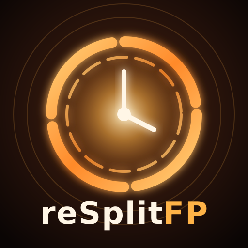

<p align="center">
  
</p>

<h1 align="center">reSplitFP</h1>

<p align="center">
  <b>TimeSplitters: Future Perfect, the original Xbox version, statically recompiled<br>
  into a native app for homebrew-enabled PS5 consoles.</b>
</p>

<p align="center">
  <a href="#install"><b>Install</b></a>
  &nbsp;·&nbsp;
  <a href="#controls">Controls</a>
  &nbsp;·&nbsp;
  <a href="#settings">Settings</a>
  &nbsp;·&nbsp;
  <a href="#reporting-a-problem">Report a problem</a>
  &nbsp;·&nbsp;
  <a href="#for-developers">Build it yourself</a>
</p>

> [!IMPORTANT]
> **Bring your own game.**
> The app is the game's program recompiled for the PS5. It contains none of the game's files: the graphics, sound,
> music and levels come from your own disc image of the US Xbox release. Please don't ask for or share disc images
> here.

> [!CAUTION]
> **We do not support piracy.**
> Please don't use this project with pirated copies of the game.

> [!NOTE]
> **A test build.** It has been played on a console into co-op Story, and in a test harness through the menus, a
> profile and the first story level. Expect rough edges, and please [report](#reporting-a-problem) what you find.

## What it is

The Xbox game's code is translated into C++ ahead of time and compiled for the PS5, as
[reUndr](https://github.com/bystritskiy/reUndr-ps5) does for Need for Speed: Underground,
[reKing](https://github.com/coru182/reKing) for The Return of the King and
[reSplit2](https://github.com/coru182/reSplit2) for TimeSplitters 2. It's not an emulator: a replacement runtime
handles the original console's graphics (Direct3D 8 on Vulkan, through Mesa's RADV), sound, input and system
services.

## Highlights

- **Widescreen at 4K.** The game's own widescreen mode, full screen at 16:9, rendered at 1080p, 1620p or 4K and
  output at 3840x2160.
- **The game's own speed** on any TV, 120 Hz ones included.
- **Up to four players** in split screen, with DualSense controllers.
- **PlayStation buttons** in the menus, prompts and tips, a PlayStation controller in Controls, and the PS5 named in
  the game's text.
- **Install it like reSplit2:** the first start unpacks your disc image; from then on the game starts straight away.

Not yet: the online modes (Xbox Live).

## Requirements

- A PS5 that runs homebrew, with [ShadowMountPlus](https://github.com/drakmor/ShadowMountPlus) (it registers apps in
  `/data/homebrew`) and an FTP server.
- Your own complete disc image (`.iso`) of TimeSplitters: Future Perfect, **US Xbox release**. A full dump and a
  trimmed one both work.
- About 4 GB free on the console for the game's files, plus the disc image until the first start has unpacked it
  (or keep the image on a USB drive).

## Install

1. **The app.** Download `PPSA99065-<version>.zip` from [Releases](../../releases), unpack it, and copy the
   `PPSA99065` folder to `/data/homebrew/` on the console. The **reSplitFP** tile appears on the home screen after
   about 30 seconds.
2. **Your disc.** Copy your disc image to `/data/tsfp/` on the console (create the folder), or to a `tsfp` folder
   (or the top) of a USB drive.
3. **Play.** Start the tile. The first start unpacks the disc image into `/data/tsfp/game/`, then the game starts.
   From then on it starts straight away, and **you can delete the `.iso`**.

Already have the disc's files (`default.xbe` and the `pak` and `xmv` folders)? Copy them to `/data/tsfp/game/`
instead. If the console has no room to unpack the image, the app plays from the `.iso` directly and says so. If the
game is missing, damaged, or another game or release, a screen says so: press Cross to close it.

**To update,** copy the new `PPSA99065` folder over the old one. Your saves, settings and the game's files in
`/data/tsfp/` are kept.

## Controls

| Xbox | DualSense |
| --- | --- |
| A B X Y | Cross Circle Square Triangle |
| Black / White | R1 / L1 |
| Left / right trigger | L2 / R2 |
| Stick clicks | L3 / R3 |
| Start / Back | Options / touchpad click |
| | **L3 + R3:** the settings menu |

Player 1 is the user who started the app. Players 2 to 4 are the other signed-in users whose controllers are on, in
the order the PS5 lists them.

## Settings

Press **L3 + R3** at any time; the game stands still behind the menu. L1 / R1 change page, Cross chooses, and
Circle, Options or L3 + R3 go back to the game. Changes apply at once and are saved when you close the menu.

| Page | Settings |
| --- | --- |
| **Picture** | Render resolution (1080p, 1620p, 4K), V-Sync, frame rate counter, texture filtering (16x by default) and sharpness, smooth menus and HUD |
| **Controls** | Vibration, stick deadzone, trigger threshold |

## Your files

| Where | What |
| --- | --- |
| `/data/homebrew/PPSA99065/` | The app |
| `/data/tsfp/game/` | The game's files, unpacked from your disc image at the first start |
| `/data/tsfp/settings.toml` | Settings |
| `/data/tsfp/hdd/` | Saves (your profiles and progress) |
| `/data/tsfp/shadercache/` | Compiled shaders, made as you play (safe to delete) |
| `/data/tsfp/logs/` | Logs, only while `/data/tsfp/logging-on` exists |

## Reporting a problem

Open an [issue](../../issues): say what you were doing, what you expected and what happened, with a screenshot if you
can. To get a log, create an empty file `/data/tsfp/logging-on` on the console and start the game; attach the newest
`/data/tsfp/logs/tsfp_*.log` and `stderr.log`, then delete `logging-on` again. **Never attach game files or disc
images.**

## For developers

Players don't need any of this: the [Releases](../../releases) have the app ready to copy.

### Building

You need a Linux machine (Ubuntu 24.04; WSL 2 should do) with:

```sh
sudo apt install git cmake ninja-build clang-18 lld-18 llvm-18 llvm-18-dev zlib1g-dev python3 python3-pip patch zip
```

and Docker, for reUndr-ps5's PS5 toolchain. You also need `default.xbe` from your own disc image of the US release:
extract it from the `.iso` with an Xbox ISO tool such as `extract-xiso`.

```sh
git clone https://github.com/coru182/reSplitFP.git
cd reSplitFP
./setup.sh /path/to/default.xbe     # dependencies, then the game's code recompiled from your default.xbe
./build-ps5.sh                      # the app: build-ps5/PPSA99065-<version>.zip
```

`setup.sh` downloads the pinned dependencies into `deps/` and builds reUndr-ps5's PS5 toolchain with its own scripts,
about 20 minutes the first time. With a built reUndr-ps5 checkout already at hand, pass it:
`REUNDR=/path/to/reUndr-ps5 ./setup.sh ...` (and the same `REUNDR=` for `build-ps5.sh`).

At start the app checks the disc's `default.xbe` against the one it was built from (`ps5/xbe_match.h`).

### How it fits together

- `game/`: this port's own files over the game template of [Athelas](https://github.com/Shagg88/Athelas) 1.8.2's
  SDK: `config/game.toml`, the recompiler's input (where the XDK 5849 library functions the runtime replaces sit in
  Future Perfect, found with the SDK's signatures, Cxbx-Reloaded's
  [XbSymbolDatabase](https://github.com/Cxbx-Reloaded/XbSymbolDatabase) and by hand: `config/manual.toml`), and
  `src/`.
- `patches/athelas-ps5.patch`: the SDK's changes for the PS5, from reKing.
- `patches/tsfp-sdk.patch`: the TimeSplitters ports' SDK changes: reSplit2's (XDK 4721, shader programs set
  directly, the music stream's status, occlusion queries in Vulkan) and Future Perfect's: the video overlay its XMV
  player shows the films with, Swap in the XDK's copy mode, vertex arrays the game sets with its own GPU commands,
  the fog its pixel shaders read, sound stream positions.
- `ps5/`: the PS5 host, from reSplit2 and reKing: the entry point, the first start (the disc image unpacked, its
  screens), the app shell and settings, DualSense input for four players, sound, the in-game menu.
- [reUndr-ps5](https://github.com/bystritskiy/reUndr-ps5) by bystritskiy: the pinned PS5 toolchain (mihawk-99's
  PS5_PayloadSDK and PS5_Vulkan with Mesa RADV), its link recipe and packaging tool.

## Credits

- [Athelas](https://github.com/Shagg88/Athelas) by Shagg, the SDK this port builds on
- [XboxXBE-Recomp](https://github.com/TGP482/XboxXBE-Recomp) by TGP482
- [reUndr-ps5](https://github.com/bystritskiy/reUndr-ps5) by bystritskiy
- Cxbx-Reloaded's [XbSymbolDatabase](https://github.com/Cxbx-Reloaded/XbSymbolDatabase)
- mihawk-99's PS5_Vulkan, PS5_Mesa and PS5_PayloadSDK

## Licence

reSplitFP's own code is GPL-3.0 ([LICENSE](LICENSE)); `package/licenses/NOTICE.txt` lists every part and its terms.

## Legal

An unofficial fan project, not affiliated with or endorsed by Free Radical Design, Electronic Arts, Deep Silver,
Plaion, Microsoft or Sony Interactive Entertainment. TimeSplitters is a trademark of its owners. No game files are
included or distributed.
